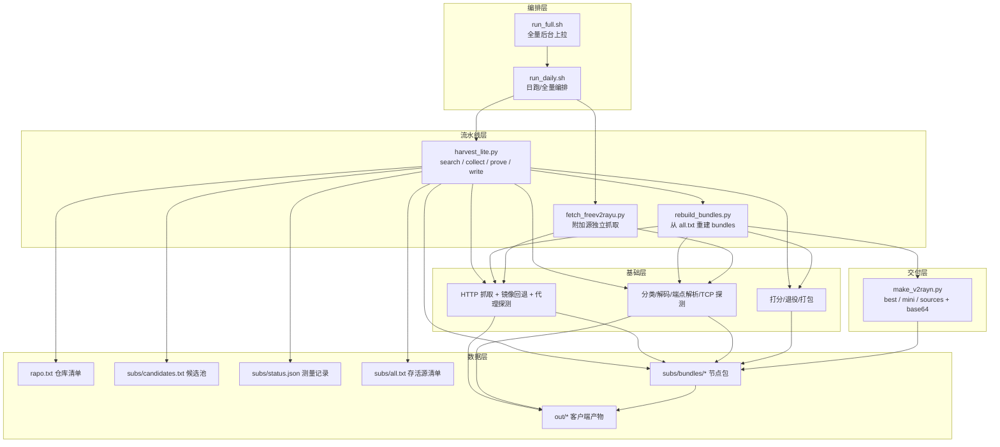
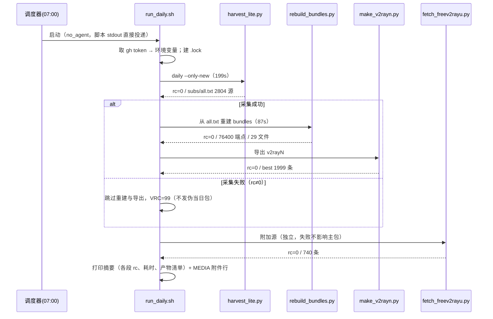

# 系统分析与架构设计

| 项 | 内容 |
|---|---|
| 文档版本 | v1.0（2026-11-01） |
| 上游文档 | `01-需求规格说明书.md` |
| 下游文档 | `04-详细设计.md`（实现级） |

---

## 1. 系统上下文

```
                    ┌──────────────────────────┐
   GitHub 公开仓库 ─┤                          │
   (raw / api)      │                          │
                    │   订阅节点收割流水线       │──→ out/      客户端节点包（v2rayN）
   Free V2rayU 站点 ─┤       （本系统）         │──→ subs/     订阅源清单 + 状态 + bundles
   (静态站)         │                          │──→ logs/     分日日志
                    └──────────────────────────┘
                              ▲
                              │ 触发
                    ┌─────────┴─────────┐
                    │ 调度器（Hermes    │
                    │ cron / launchd /  │
                    │ 手动）            │
                    └───────────────────┘
```

外部依赖只有两处网络来源（GitHub 生态、一个静态站），无数据库、无服务端、无第三方包。

---

## 2. 分层视图



**分层原则**：编排层只管顺序与失败隔离，流水线层只管「业务四步」，交付层只管格式转换，
基础层是被复用的能力（HTTP / 解析 / 打分），数据层是纯文件。

---

## 3. 核心流水线（五阶段）

```
 ┌─────────┐   ┌─────────┐   ┌─────────┐   ┌─────────┐   ┌──────────────┐
 │ search  │──▶│ collect │──▶│  prove  │──▶│  write  │──▶│ rebuild+export│
 └─────────┘   └─────────┘   └─────────┘   └─────────┘   └──────────────┘
      │              │             │            │               │
   12组关键词      README+路径    抓取+分类    打分+退役      重建bundles
   Search API      URL规范化      TCP抽样      all.txt        转v2rayN
      │              │             │            │               │
   rapo.txt     candidates.txt  status.json  all.txt        out/*, bundles/*
```

### 3.1 阶段数据契约

| 阶段 | 输入 | 输出 | 失败语义 |
|---|---|---|---|
| search | 关键词表 | `rapo.txt`（只增） | 单次查询失败跳过，不影响整体 |
| collect | `rapo.txt` | `candidates.txt`（`url\trepo`） | 单仓库失败跳过 |
| prove | `candidates.txt` + 已有 `status.json` | `status.json`（全量重写） | 单链接失败记 `dead`，不中断 |
| write | `status.json` | `all.txt`、`retired.txt` | 无存活源时不覆盖 all.txt |
| rebuild | `all.txt` | `bundles/*` | 唯一端点 < 阈值 → **拒绝写入**（rc=3） |
| export | `bundles/*` | `out/v2rayN-*` | 上游失败则不导出（rc=99） |

> 这张表是全系统的「契约中心」：任何改造都必须保持每阶段输入输出的可重入性。

---

## 4. 关键时序

### 4.1 日跑（增量）时序



### 4.2 全量（周跑）时序

```
04:00  run_full.sh ──(nohup, 秒级返回)──▶ run_daily.sh MODE=full
                                          └─ harvest 全量重证（约 16 分钟）
                                             └─ 写 status/all/bundles（真·全量，64260 配置）
07:00  run_daily.sh daily ──▶ 读入全量结果做增量 + 重建 + 导出
```

**为什么拆两步**：全量 16 分钟，同步执行有被调度器超时杀掉的风险（历史上确实发生过 rc=143）。
后台拉起 + 次日早晨读结果，让「长任务」和「交付时点」解耦。

---

## 5. 状态机

### 5.1 单个订阅源的生命周期

```
        发现
         │
         ▼
   ┌───────────┐  抓取分类非configs   ┌────────┐
   │ candidate │─────────────────────▶│  dead  │
   └───────────┘                      │ html   │
         │ 抓取到 ≥2 条配置            │ empty  │
         ▼                            │ other  │
   ┌───────────┐                      └────────┘
   │  configs  │◀── 复测通过 ──┐            │
   └───────────┘               │            │
     │      │  14 天无存活/无变更            │
     │      └──────────────────────────────▶│
     │                                      ▼
     │                              ┌──────────────┐
     └── 分数 ≥ 85 ──▶ 进入 best 包 │  retired.txt │
                                    │（只记录不删）│
                                    └──────────────┘
                                           │ 源回归
                                           └──▶ 重新进入 prove
```

### 5.2 任务执行状态（可观测性用）

| 状态 | 触发 | 摘要表现 |
|---|---|---|
| OK | 采集 rc=0、重建 rc=0、导出 rc=0 | 正常产物清单 |
| 采集失败 | 采集 rc≠0 | `⚠️ 采集失败 daily rc=N`，`导出 rc=99` |
| 重建保护 | 唯一端点 < 500 | `⚠️ bundles 重建 rc=3`，沿用旧 bundles 导出 |
| 附加源失败 | freev2rayu rc≠0 | 主包照常，附加源单列 rc |
| 跳过 | `.lock` 存在且 pid 存活 | 「跳过：另一个采集进程仍在运行」 |

---

## 6. 数据模型

### 6.1 实体关系

```
repository (rapo.txt)          1 ──── n  source_link (candidates.txt)
                                             │
                                             │ 测量
                                             ▼
                                     source_record (status.json)
                                             │ 评分通过
                                             ▼
                                     alive_source (all.txt)
                                             │ 抓取配置
                                             ▼
                                     config_uri ──(端点去重)──▶ bundle_entry
                                                                      │ 导出
                                                                      ▼
                                                              client_package (out/)
```

### 6.2 关键字段（详见 `04-详细设计.md` §4）

- `status.json.links[url]`：`kind / configs / protocols / reachRatio / medianLatencyMs / digest / lastAlive / score …`
- `all.txt`：注释头 + 每行一个 URL（分数降序，**顺序即客户端尝试顺序**）
- `bundles/index.txt`：包名 → 配置数清单
- `out/*`：客户端可导入的明文 / base64

---

## 7. 调度与部署

### 7.1 部署形态

单机、单目录、扁平布局：

```
<run_dir>/
  harvest_lite.py  make_v2rayn.py  fetch_freev2rayu.py  rebuild_bundles.py
  run_daily.sh     run_full.sh
  rapo.txt
  subs/   out/   logs/   .cache/
```

脚本以**自身所在目录**为运行目录（`RUN="${HARVEST_RUN_DIR:-$(dirname $0)}"`），因此整个目录可搬到任意机器。

### 7.2 调度方案

| 方案 | 命令 | 说明 |
|---|---|---|
| Hermes cron（现用） | 日跑 07:00；周跑 周日 04:00 | 脚本型任务设 `no_agent=true`，stdout 逐字投递，不消耗模型 |
| crontab | `0 7 * * * cd <run_dir> && ./run_daily.sh` | 通用替代 |
| launchd | StartCalendarInterval | macOS 原生 |
| 手动 | `./run_daily.sh` / `MODE=full ./run_daily.sh` | 补跑 |

### 7.3 失败域划分

| 失败域 | 影响面 | 隔离手段 |
|---|---|---|
| 单个源抓取失败 | 该源本次判 dead | 批内 try/except，继续下一个 |
| 采集整体失败 | 当日无新数据 | 跳过导出，保留旧产物，摘要告警 |
| 重建失败 | bundles 可能退化 | 阈值保护，宁保留旧包 |
| 导出失败 | 无当日客户端包 | rc 上报，不影响 subs 状态 |
| 附加源失败 | 少一个补充包 | 完全隔离，退出码不影响主流程 |
| 调度器杀进程 | 本次白跑（历史 rc=143） | 全量改 nohup；日跑控制在 10 分钟内 |

---

## 8. 架构决策记录（ADR 摘要）

| 编号 | 决策 | 理由 | 代价 |
|---|---|---|---|
| ADR-01 | 状态用 JSON/文本文件而非数据库 | 零依赖、可直接 diff、可用 `md5` 校验真伪 | 全量重写 4MB，随历史增长变慢 |
| ADR-02 | 打分以可达性为主、延迟为 tiebreak | 实测延迟与真实可用性弱相关 | 同分源之间排序靠体验而非数值 |
| ADR-03 | 增量 + 周期全量双轨 | 全量 16 分钟不适合天天跑，纯增量会漂移 | 需要两套调度 |
| ADR-04 | 端点去重（而非 URI 去重） | 同一服务器多协议/多 URI 只保留一条，包更干净 | 会丢弃同机的不同协议副本 |
| ADR-05 | bundles 端点上限 2000（best） | 客户端导入过多会拖慢启动与测速 | 极端高分散场景下牺牲少量好节点 |
| ADR-06 | 增量后强制重建 bundles | 否则当日包是旧数据重导出（已发生事故） | 每日多 90 秒 |
| ADR-07 | 附加源独立成文件、不并入主包 | 保持主包可复现（只依赖 GitHub 生态） | 用户多导入一个包 |
| ADR-08 | 脚本 stdout 即汇报（no_agent 调度） | 无模型依赖，免疫模型漂移导致的静默跳过 | 汇报格式必须由脚本保证 |
